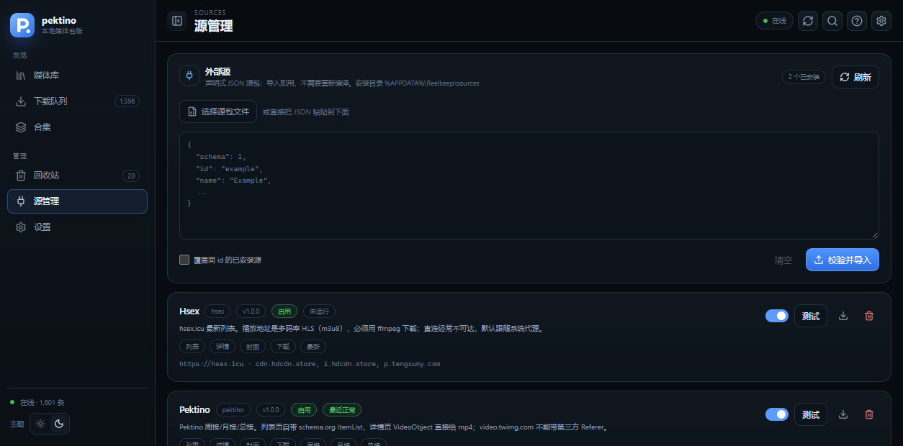

# Reelkeep

本地的视频台账与下载管理器：抓取榜单 → 生成直链 → 内置下载器 → 扫盘回填 → 表格 / 画廊浏览 → 打分 / 收藏 / 合集 / 抽卡。

**Reelkeep 是 Pektino 的 Go 重写版。** 同一套 React 前端、同一份 SQLite 数据、同一套 `/api/*` 契约；后端从 PowerShell 5.1 换成单二进制 Go，为多端（Windows / macOS / Linux，后续 Android）留出同源代码。

当前状态：**P1 完成 + P6 完成（外部源包 / 源管理 / 抓取任务）+ P2 部分（pektino、hsex 已作为外部源跑通）**。可以打开旧项目、浏览 1,600+ 条台账、扫盘回填、收藏/评分/已看/回收站/合集、浏览器内播放（Range 流）、在「源管理」导入源包并直接抓取。下载器（P4）、qise/web 原生适配器、Wails 壳（P5）尚未完成。



---

## 快速开始

需要 Go 1.26+（构建）。运行不需要 Node.js、不需要 PowerShell、不需要数据库服务。

```powershell
# 构建（Windows）
.\scripts\build.ps1

# 运行：默认打开最近项目；首次使用会创建 <文档>\Reelkeep
.\reelkeep.exe

# 指定旧项目（数据完全兼容）
.\reelkeep.exe -project D:\project\pektino-project -no-browser
```

打开 `http://127.0.0.1:8791/`。端口被占用会自动向后找，以窗口打印为准。

命令行参数：

| 参数 | 说明 |
|---|---|
| `-port` | 监听端口，默认 8791 |
| `-project` | 项目目录（数据单元）；留空用最近项目/默认目录 |
| `-no-browser` | 不自动打开浏览器 |
| `-version` | 打印版本号 |

## 项目与数据

和旧版一样，**程序与数据分离**：

```text
<程序目录>
  reelkeep.exe          单二进制（内嵌 web/dist）

<项目目录>
  project.json
  data\                 data.db · config.json · ledger.csv · deleted.json · logs\ · snapshots\
  media\                <source>\<token>.mp4
  cache\covers\         封面缓存（可删）
  cache\thumbs\         缩略图缓存（可删）
```

- `data.db` 是事实来源（SQLite WAL），`ledger.csv` 是导出快照，34 列与原版逐字段一致
- 升级程序不动数据；换项目 = 换一个目录
- 路径支持中文和空格；不要把项目放在 OneDrive / 坚果云 / 网络盘（SQLite WAL 可能损坏，启动时会警告）
- 首次运行会读取旧版 `%APPDATA%\pektino\projects.json`，自动打开你原来的项目

## 外部源包

除了内置 Go 适配器，还可以导入声明式源包（不需要重新编译）：

- 界面：**源管理** → 选择文件或粘贴 JSON → 「校验并导入」→ 启用 → 在「获取数据」里选它
- 源包能力：HTML 列表 / JSON 接口 / schema.org `ItemList`、详情 CSS + JSON-LD、封面、HTTP/HLS 下载地址
- 安装位置：`%APPDATA%\Reelkeep\sources\<id>.json`

```powershell
# 校验（一次列出所有问题）
.\reelkeep.exe source validate .\my-source.json

# 离线回放：用本地 HTML 代替网络，不需要联网
.\reelkeep.exe source test .\my-source.json --fixture-list list.html --fixture-detail detail.html --resolve

# 在线测试：先抓 2 条验证
.\reelkeep.exe source test .\my-source.json --rank weekly --limit 2 --resolve

# 安装 / 查看 / 删除 / 导出
.\reelkeep.exe source install .\my-source.json --overwrite
.\reelkeep.exe source list
.\reelkeep.exe source remove example
.\reelkeep.exe source export example
```

仓库自带两个已验证的源包，可直接导入：

| 文件 | 站点 | 下载 |
|---|---|---|
| [sources/pektino.json](sources/pektino.json) | Pektino 周/月/总榜 | http（twimg 不带 Referer） |
| [sources/hsex.json](sources/hsex.json) | hsex 最新 | HLS（需 ffmpeg；默认跟随系统代理） |

- 机器可读格式：[docs/schema/source.schema.json](docs/schema/source.schema.json)
- 人类可读参考：[skills/reelkeep-source/references/schema.md](skills/reelkeep-source/references/schema.md)
- 安全边界：域名白名单、拒绝 `file:` 与内网地址、响应大小/超时上限、重定向校验；本地代理地址单独放行
- 让 LLM 生成源包时，加载 `reelkeep-source` skill（已随仓库提供）

## 架构

```text
cmd/reelkeep            进程入口：单实例、端口回退、打开浏览器、优雅退出；source 子命令
internal/api            HTTP 契约（/api/* 与旧版一致）+ SSE + 静态资源
internal/store          SQLite：items / collections / deleted_tokens / audit_log
internal/scan           媒体目录 → 台账回填（与旧版判定逐条对齐）
internal/source         源注册表（sources.json 控制启用/顺序/榜单）
internal/rule           外部源包：加载/校验、安全抓取、HTML/JSON 提取、RuleSource
internal/config         项目路径模型、settings、最近项目、导入源目录
internal/jsonx          兼容 PowerShell 写出的 UTF-8 BOM JSON
web/                    React 19 + Vite 8 前端（构建产物 go:embed 进二进制）
configs/sources.json    内置源的启用/能力/榜单清单
docs/schema/            源包 JSON Schema（2020-12）
skills/reelkeep-source  指导 LLM 生成/校验/安装源包的 skill
```

设计约束：

- 内核不依赖 HTTP 框架，`Source` 用能力接口协商（`Detailer` / `Coverer` / `DownloadResolver`），下载器不出现源名分支
- 一个内核、多个壳：桌面/服务器只是启动方式不同，业务逻辑零复制
- 前端只认统一 schema 与 `/api/*`，不写 `if (source === 'qise')`
- 媒体流走同进程 `http.ServeContent`，支持 Range / HEAD，只监听回环并校验进程内 key

## 与旧版的数据契约

迁移的第一原则是**逐字段兼容**：

- `items` 表 34 列名称/类型/默认值不变，只允许新增列
- `ledger.csv` 表头、列顺序、导出编码（UTF-8 BOM + CRLF）不变
- `deleted.json` / `deleted_tokens` 双向保留；彻底删除在扫盘路径上必须过滤
- token 语义不变：默认源裸 token，其他源 `<source>@<id>`
- 媒体索引规则不变：递归 4 层、去掉 ` (1)` 重名后缀、大小写不敏感

## 开发

```powershell
go test ./...                              # 单元测试（纯 Go，CGO_ENABLED=0）
go vet ./...
gofmt -l .

cd web; pnpm install; pnpm build           # 重新构建前端（产物在 web/dist）
```

构建脚本会把 `web/dist` 一起 embed；改了前端必须重新构建二进制。

## 路线图

| 阶段 | 内容 | 状态 |
|---|---|---|
| P0 | 契约冻结、诊断基线、25 项 HTTP 验收测试 | 待做 |
| P1 | Go 内核骨架：store / scan / API / 静态资源 / 媒体流 | **完成** |
| P2 | 四个源适配器迁移（pektino / hsex / qise / web） | 部分：pektino、hsex 已用外部源包验证；qise/web 待做 |
| P3 | 写路径补齐：封面/缩略图/快照/导入/播放器调用 | 部分完成 |
| P4 | 下载器 + 队列持久化 + 410 刷新 + 续传 | 待做 |
| P5 | 打包（Windows 单文件）+ CI + Wails 壳 + macOS/Linux | 待做 |
| P6 | 外部源包：格式/校验/安全抓取/CLI/skill/源管理/抓取任务 | **完成** |

## 许可

[MIT](LICENSE)
