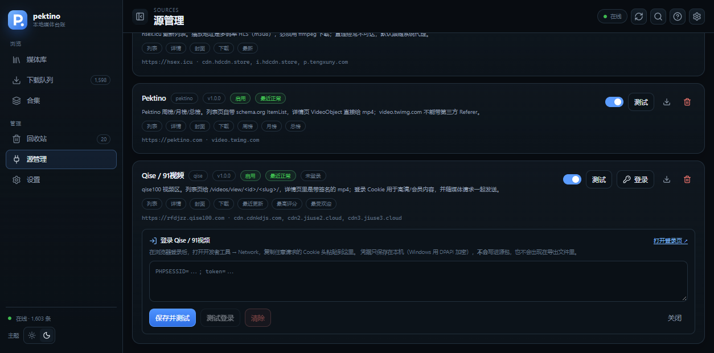

# Reelkeep

本地的视频台账与下载管理器：抓取榜单 → 生成直链 → 内置下载器 → 扫盘回填 → 表格 / 画廊浏览 → 打分 / 收藏 / 合集 / 抽卡。

**Reelkeep 是 Pektino 的 Go 重写版。** 同一套 React 前端、同一份 SQLite 数据、同一套 `/api/*` 契约；后端从 PowerShell 5.1 换成单二进制 Go，为多端（Windows / macOS / Linux，后续 Android）留出同源代码。

当前状态：**P1 / P2 / P3 / P6 完成，P4 下载器基础版，P5 桌面壳与项目管理可用（Windows）**。可以打开任意文件夹作为项目、切换最近项目、桌面新窗口/浏览器新实例、导入媒体、浏览台账、封面/缩略图、时间轴快照、播放、榜单/链接抓取、刷新地址、下载（HTTP 续传 / HLS）。安装器/签名/自动更新（P5）、macOS/Linux 桌面包尚未完成。


---

## 快速开始

需要 Go 1.26+（构建）。运行不需要 Node.js、不需要 PowerShell、不需要数据库服务。

```powershell
# 构建（Windows）
.\scripts\build.ps1

# 运行：默认打开最近项目；首次使用会创建 <文档>\Reelkeep
.\reelkeep.exe

# 指定旧项目（数据完全兼容）
.\reelkeep.exe -project D:\project\pektino-project -no-browser
```

打开 `http://127.0.0.1:8791/`。端口被占用会自动向后找，以窗口打印为准。

命令行参数：

| 参数 | 说明 |
|---|---|
| `-port` | 监听端口，默认 8791 |
| `-project` | 项目目录（数据单元）；留空用最近项目/默认目录 |
| `-no-browser` | 不自动打开浏览器 |
| `-version` | 打印版本号 |

## 项目与数据

和旧版一样，**程序与数据分离**：

```text
<程序目录>
  reelkeep.exe          单二进制（内嵌 web/dist）

<项目目录>
  project.json
  data\                 data.db · config.json · ledger.csv · deleted.json · logs\ · snapshots\
  media\                <source>\<token>.mp4
  cache\covers\         封面缓存（可删）
  cache\thumbs\         缩略图缓存（可删）
```

- `data.db` 是事实来源（SQLite WAL），`ledger.csv` 是导出快照，34 列与原版逐字段一致
- 升级程序不动数据；换项目 = 换一个目录
- 路径支持中文和空格；不要把项目放在 OneDrive / 坚果云 / 网络盘（SQLite WAL 可能损坏，启动时会警告）
- 首次运行会读取旧版 `%APPDATA%\pektino\projects.json`，自动打开你原来的项目

## 外部源包

除了内置 Go 适配器，还可以导入声明式源包（不需要重新编译）：

- 界面：**源管理** → 选择文件或粘贴 JSON → 「校验并导入」→ 启用 → 在「获取数据」里选它
- 源包能力：HTML 列表 / JSON 接口 / schema.org `ItemList`、详情 CSS + JSON-LD、封面、HTTP/HLS 下载地址
- 安装位置：`%APPDATA%\Reelkeep\sources\<id>.json`
- 源管理里点 **JSON 图标**可以查看完整源包：`/api/sources` 只是列表摘要，后端加载的是这份完整 JSON；规则源由通用引擎执行，只有 `web` 是原生适配器
- **登录 Cookie**：桌面端在源管理点「登录」→「应用内登录」，首次登录后关闭登录窗口会自动读取并保存 Cookie（含 HttpOnly）；已有凭据时点「读取 Cookie」覆盖。Web 端仍是手动粘贴

```powershell
# 校验（一次列出所有问题）
.\reelkeep.exe source validate .\my-source.json

# 离线回放：用本地 HTML 代替网络，不需要联网
.\reelkeep.exe source test .\my-source.json --fixture-list list.html --fixture-detail detail.html --resolve

# 在线测试：先抓 2 条验证
.\reelkeep.exe source test .\my-source.json --rank weekly --limit 2 --resolve

# 安装 / 查看 / 删除 / 导出
.\reelkeep.exe source install .\my-source.json --overwrite
.\reelkeep.exe source list
.\reelkeep.exe source remove example
.\reelkeep.exe source export example
```

仓库自带两个已验证的源包，可直接导入：

| 文件 | 站点 | 下载 |
|---|---|---|
| [sources/pektino.json](sources/pektino.json) | Pektino 周/月/总榜 | http（twimg 不带 Referer） |
| [sources/hsex.json](sources/hsex.json) | hsex 最新 | HLS（需 ffmpeg；默认跟随系统代理） |
| [sources/qise.json](sources/qise.json) | qise 视频区 | http 签名 mp4（登录后高清/会员） |

### 需要登录的源（手动 Cookie）

qise 这类站点，高清/会员内容需要登录态。Reelkeep **不代填账号密码**，而是复用你自己的浏览器会话：

1. 「源管理」→ 对应源 → 「登录」
2. 点「打开登录页」，在浏览器里正常登录
3. 开发者工具 → Network → 任意请求 → 复制 `Cookie` 请求头
4. 粘贴 → 「保存并测试」



- 凭据保存在 `%APPDATA%\Reelkeep\secrets\<source>.json`，Windows 用 **DPAPI 加密**（绑定当前 Windows 账户）
- 凭据不会写进源包，导出/分享源包时不会带出去
- 旧版的 `qiseCookie` 会在首次启动时自动迁移一次
- 只复用你账号本来就有权限的内容，不绕过会员墙 / DRM

### 格式与安全

- 机器可读格式：[docs/schema/source.schema.json](docs/schema/source.schema.json)
- 人类可读参考：[skills/reelkeep-source/references/schema.md](skills/reelkeep-source/references/schema.md)
- 安全边界：域名白名单、拒绝 `file:` 与内网地址、响应大小/超时上限、重定向校验；本地代理地址单独放行
- 让 LLM 生成源包时，加载 `reelkeep-source` skill（已随仓库提供）

## 下载

「下载队列」页可以直接消耗台账里的 `url`：

- HTTP 断点续传（`Range` / `.part` / 原子改名），进程重启后未完成任务回到队列
- HLS 交给 ffmpeg（设置里填路径或加入 PATH）；签名过期且源声明了 `410` 时先刷新详情再重试一次
- 暂停/继续（全局或单条）、取消（清 `.part`）、清理完成、失败重试
- 全局并发 + 每源上限 2；下载请求带浏览器 UA，IPv4 优先，302 跨域仍保留 Referer
- 完成后自动回填台账（状态 `done`、文件路径/大小），媒体库与预览立即可用
- 旧版 `.queue.json` 首次启动自动迁移

> 下载内容来自第三方站点，是否可下载/保存请自行确认合规性；本程序只复用你账号已有权限，不绕过会员墙或 DRM。

## 链接抓取与刷新地址

- 粘贴任意视频页面或直链：「链接抓取」默认用 `web` 源
  - 直链（mp4/m3u8）直接建条目；页面解析 `og:title/og:image/og:video`、`<video>/<source>`、JSON-LD
  - token 为 `web@<URL md5 前 12 位>`，同一链接重复抓取会合并
- 规则源（qise / pektino）也支持贴详情页 URL：用列表 id 正则提取原生 id，再走详情解析
- 地址过期用「刷新地址」：优先重抓页面，其次 `Refresher`，再 `Resolve`；一次最多 20 条
- 代理设置对 web 源与内置下载器都生效

## 项目管理（IDEA 式）

项目就是一个文件夹（`project.json + data/ + media/`），不是程序里的「库」：

- 启动 `reelkeep.exe -project D:\Reelkeep\某项目`，或用桌面版的「打开文件夹」入口
- 空文件夹会自动初始化为项目；非空且不是项目的目录会被拒绝
- 侧边栏显示当前项目名，点开切换器可以：看最近项目、输入路径打开/新建、**浏览… 调起系统文件夹选择器**（桌面端）、在资源管理器中定位
- 切换项目会打开**新窗口/新实例**：每个项目独立端口、数据库、媒体目录；同一项目重复打开则复用已有服务
- 最近项目记录在 `%APPDATA%\Reelkeep\projects.json`，换项目不用重装外部源

## 桌面壳（Windows）

`reelkeep-desktop.exe` 是 Wails v3 + WebView2 的原生窗口，内部仍然启动同一个 loopback HTTP 服务：

- 窗口直接加载 `http://127.0.0.1:<port>/`；**没有第二套绑定/transport**，前端与 CLI 完全同一份
- 无边框自绘标题栏：左侧项目名（点击切换），右侧最小化/最大化/关闭；深色风格与界面一致
- 源登录：登录窗口用 WebView2 打开站点，关闭时通过 CDP 读取 Cookie（含 HttpOnly），不需要手动开开发者工具
- `CGO_ENABLED=0` 可构建；WebView2 运行时 Win10/11 一般已自带
- 已有服务在跑时，双击桌面版只开窗口，不会重复启动服务
- 构建：`.\scripts\build.ps1`（同时产出 `reelkeep.exe` 与 `reelkeep-desktop.exe`）

> 安装器（NSIS）、代码签名、自动更新、macOS/Linux 桌面包还没做；当前是绿色版。

## 架构

```text
cmd/reelkeep            进程入口：单实例、端口回退、打开浏览器、优雅退出；source 子命令
desktop                  Wails v3 桌面壳（WebView2 + 本机 loopback 服务）
internal/boot            共用启动器：项目 → 数据库 → 源 → API → 下载器 → HTTP
internal/api            HTTP 契约（/api/* 与旧版一致）+ SSE + 静态资源
internal/store          SQLite：items / collections / deleted_tokens / audit_log / download_tasks
internal/scan           媒体目录 → 台账回填（与旧版判定逐条对齐）
internal/source         源注册表（sources.json 控制启用/顺序/榜单）
internal/rule           外部源包：加载/校验、安全抓取、HTML/JSON 提取、RuleSource
internal/download       下载器：队列、HTTP 续传、HLS、暂停/取消
internal/cover          封面缩略图
internal/secrets        登录凭据（Windows DPAPI）
internal/config         项目路径模型、settings、最近项目、导入源目录
internal/jsonx          兼容 PowerShell 写出的 UTF-8 BOM JSON
web/                    React 19 + Vite 8 前端（构建产物 go:embed 进二进制）
configs/sources.json    内置源的启用/能力/榜单清单
docs/schema/            源包 JSON Schema（2020-12）
skills/reelkeep-source  指导 LLM 生成/校验/安装源包的 skill
```

设计约束：

- 内核不依赖 HTTP 框架，`Source` 用能力接口协商（`Detailer` / `Coverer` / `DownloadResolver`），下载器不出现源名分支
- 一个内核、多个壳：桌面/服务器只是启动方式不同，业务逻辑零复制
- 前端只认统一 schema 与 `/api/*`，不写 `if (source === 'qise')`
- 媒体流走同进程 `http.ServeContent`，支持 Range / HEAD，只监听回环并校验进程内 key

## 与旧版的数据契约

迁移的第一原则是**逐字段兼容**：

- `items` 表 34 列名称/类型/默认值不变，只允许新增列
- `ledger.csv` 表头、列顺序、导出编码（UTF-8 BOM + CRLF）不变
- `deleted.json` / `deleted_tokens` 双向保留；彻底删除在扫盘路径上必须过滤
- token 语义不变：默认源裸 token，其他源 `<source>@<id>`
- 媒体索引规则不变：递归 4 层、去掉 ` (1)` 重名后缀、大小写不敏感

## 开发

```powershell
go test ./...                              # 单元测试（纯 Go，CGO_ENABLED=0）
go vet ./...
gofmt -l .

cd web; pnpm install; pnpm build           # 重新构建前端（产物在 web/dist）
```

构建脚本会把 `web/dist` 一起 embed；改了前端必须重新构建二进制。

## 路线图

| 阶段 | 内容 | 状态 |
|---|---|---|
| P0 | 契约冻结、诊断基线、25 项 HTTP 验收测试 | 待做 |
| P1 | Go 内核骨架：store / scan / API / 静态资源 / 媒体流 | **完成** |
| P2 | 四个源适配器迁移（pektino / hsex / qise / web）+ 链接抓取/刷新地址 | **完成** |
| P3 | 写路径补齐：封面/缩略图/快照/导入/播放器调用 | **完成** |
| P4 | 下载器 + 队列持久化 + 410 刷新 + 续传 | **完成（基础版）** |
| P5 | 打包（Windows 单文件）+ CI + Wails 壳 + macOS/Linux | 桌面壳可用；安装器/签名/CI/mac/linux 待做 |
| P6 | 外部源包：格式/校验/安全抓取/CLI/skill/源管理/抓取任务 | **完成** |

## 许可

[MIT](LICENSE)
